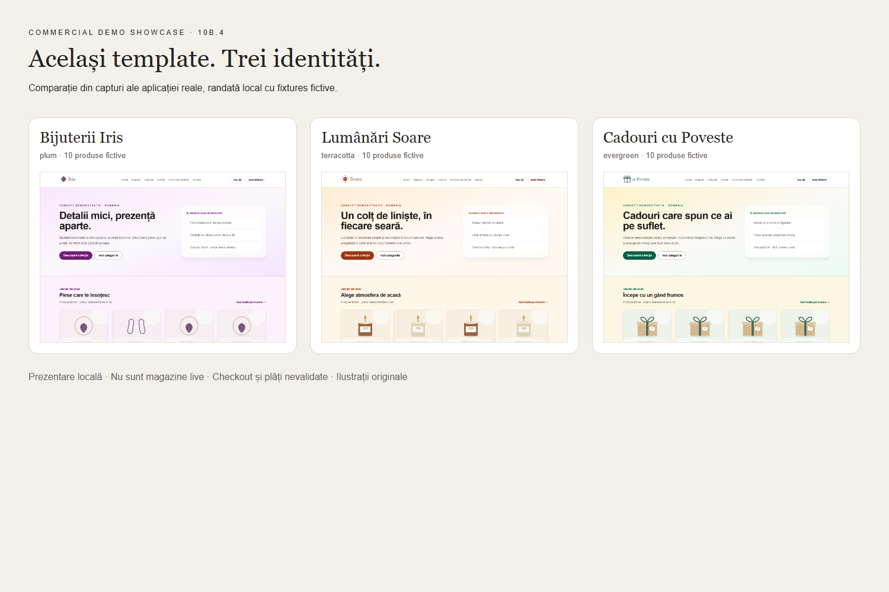
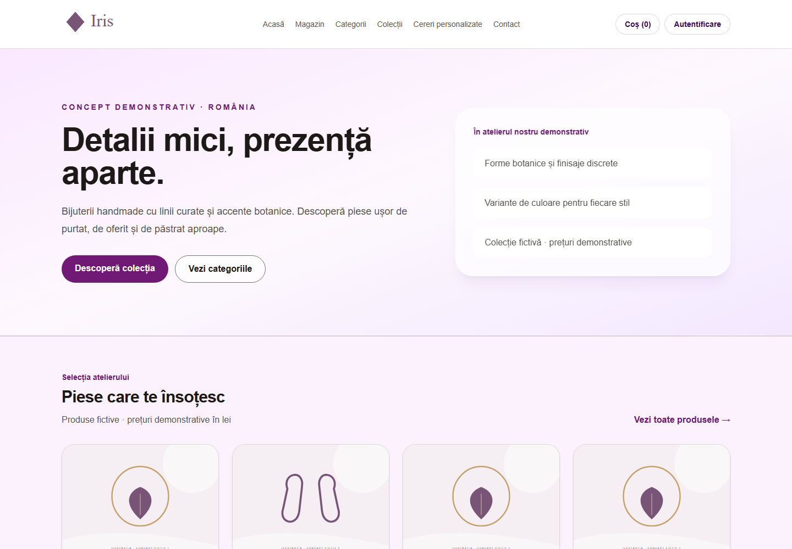
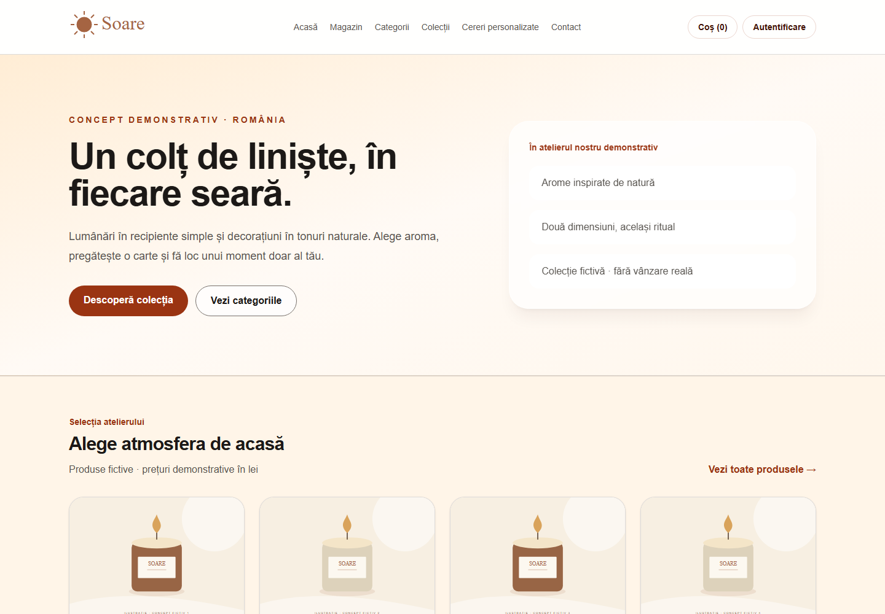
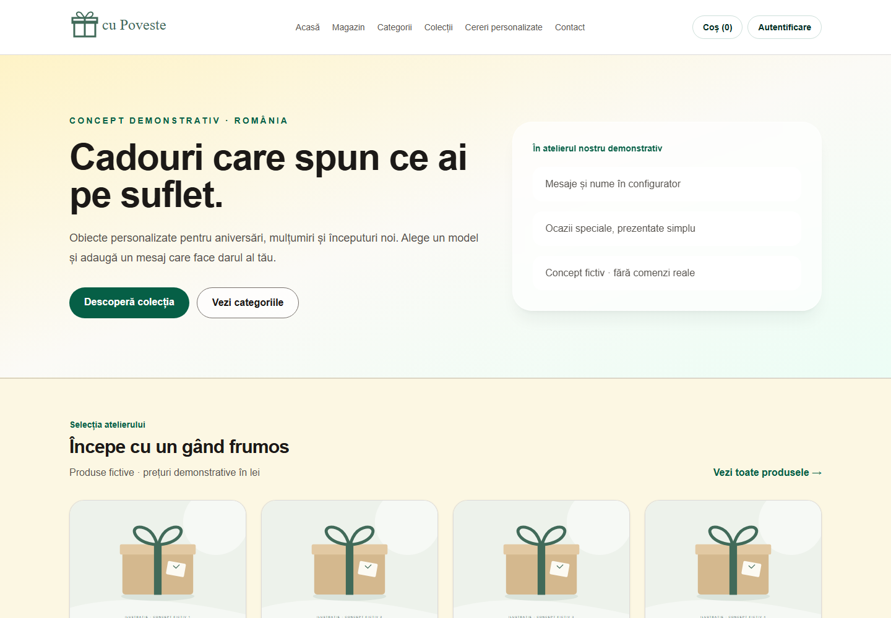

# Commercial Demo Showcase — 10B.4

Trei concepte fictive din același template master. Catalogul, componentele,
configuratorul, temele, citirea Store Settings și homepage-ul sunt cele existente.
**Prezentare locală cu fixtures HTTP, fără Supabase real. Nu sunt magazine live,
iar checkout-ul, stocul tranzacțional și plățile nu sunt certificate aici.**

## Alege conceptul

| Demo | Identitate și conținut | Date controlate | Galerie |
| --- | --- | --- | --- |
| A — Bijuterii Iris | plum, elegant/minimalist; 10 bijuterii, Coliere/Cercei/Brățări; finisaje auriu/argintiu | [iris.json](data/iris.json) | [Capturi Iris](#bijuterii-iris) |
| B — Lumânări Soare | terracotta, cald/natural; 10 lumânări/decorațiuni/accesorii; recipiente 120/220 g | [soare.json](data/soare.json) | [Capturi Soare](#lumânări-soare) |
| C — Cadouri cu Poveste | evergreen; 10 cadouri pentru familie/aniversări/mulțumiri; formate, mesaj, ocazie, ambalaj | [poveste.json](data/poveste.json) | [Capturi Poveste](#cadouri-cu-poveste) |

Fiecare JSON include Store Settings publice, configurarea brandului, cele cinci
sloturi homepage, categorii/colecție, 10 produse descrise, variante, personalizări
și inventar fictiv pentru documentarea datelor. Inventarul nu este folosit drept
dovadă de disponibilitate tranzacțională. Nu sunt incluse conturi, date personale,
recenzii, comenzi sau plăți fabricate. Prețurile sunt exemple comerciale RON,
fără ofertă reală. Nu se poate deduce conformitatea fiscală sau juridică din demo.

## Comparație vizuală

Comparația este un colaj din capturi locale ale homepage-urilor reale Next.js,
nu un nou ecran al magazinului. Capturile de mai jos sunt ale rutelor randate de
aplicație; nu s-a folosit `setContent` pentru a recrea homepage-ul sau produsul.
Doar colajul comparativ este compus separat. Nu sunt fotografii de produse:
[proveniența și drepturile ilustrațiilor](ASSET-PROVENANCE.md) sunt documentate.

## Bijuterii Iris

Brand minimalist cu paleta plum, logo geometric și colecția „Botanica de zi cu zi”.
Piesa demonstrată: Colier Petală; selecția „Argintiu mat” schimbă estimarea de
la 129 la 141 RON folosind configuratorul existent.

[Homepage desktop complet](screenshots/iris/homepage-desktop.png) ·
[Homepage mobile](screenshots/iris/homepage-mobile.png) ·
[Catalog](screenshots/iris/catalog-desktop.png) ·
[Produs desktop](screenshots/iris/product-desktop.png) ·
[Produs mobile](screenshots/iris/product-mobile.png) ·
[Variante desktop](screenshots/iris/options-desktop.png) ·
[Variante mobile](screenshots/iris/options-mobile.png).

## Lumânări Soare

Paleta terracotta, logo solar și colecția „Seri de toamnă”. Lumânare Amurg
are recipiente 120 g / 220 g: 59 / 87 RON. Textul catalogului evită promisiuni
terapeutice și nu presupune certificări reale pentru materialele fictive.

[Homepage desktop complet](screenshots/soare/homepage-desktop.png) ·
[Homepage mobile](screenshots/soare/homepage-mobile.png) ·
[Catalog](screenshots/soare/catalog-desktop.png) ·
[Produs desktop](screenshots/soare/product-desktop.png) ·
[Produs mobile](screenshots/soare/product-mobile.png) ·
[Variante desktop](screenshots/soare/options-desktop.png) ·
[Variante mobile](screenshots/soare/options-mobile.png).

## Cadouri cu Poveste

Paleta evergreen, logo cadou și colecția „Momente de păstrat”. Cutie Amintiri
arată formatul generos (119 RON), textul „Pentru Ana” (+10), ocazia Aniversare
(fără cost) și ambalajul (+8): estimare 137 RON. Nu include upload privat de imagini.

[Homepage desktop complet](screenshots/poveste/homepage-desktop.png) ·
[Homepage mobile](screenshots/poveste/homepage-mobile.png) ·
[Catalog](screenshots/poveste/catalog-desktop.png) ·
[Produs desktop](screenshots/poveste/product-desktop.png) ·
[Produs mobile](screenshots/poveste/product-mobile.png) ·
[Personalizări desktop](screenshots/poveste/options-desktop.png) ·
[Personalizări mobile](screenshots/poveste/options-mobile.png).

## Scenariu pentru prezentare

1. Prezintă comparația și precizează că brandurile, produsele și prețurile sunt fictive.
2. Deschide un demo local, navighează homepage → Magazin → categorie → produs.
3. Selectează varianta; la Cadouri completează mesajul/ocazia/ambalajul și urmărește
   prețul orientativ. Adăugarea în coș demonstrează numai coșul local din browser.
4. Arată versiunea mobile. Nu prezenta lipsa overflow-ului drept audit complet de
   accesibilitate, nici absența unei erori browser drept validare de securitate.
5. Explică traseul unei instalări client separate și gate-urile rămase; nu iniția
   checkout, signup, newsletter, cerere, plată sau refund în această prezentare.

[Reproducere și arhitectură locală](REPRODUCING.md) ·
[Raport de validare](VALIDATION.md) · [Rezultate captură](validation.json) ·
[Pachet de livrare client](../client-delivery/README.md).
